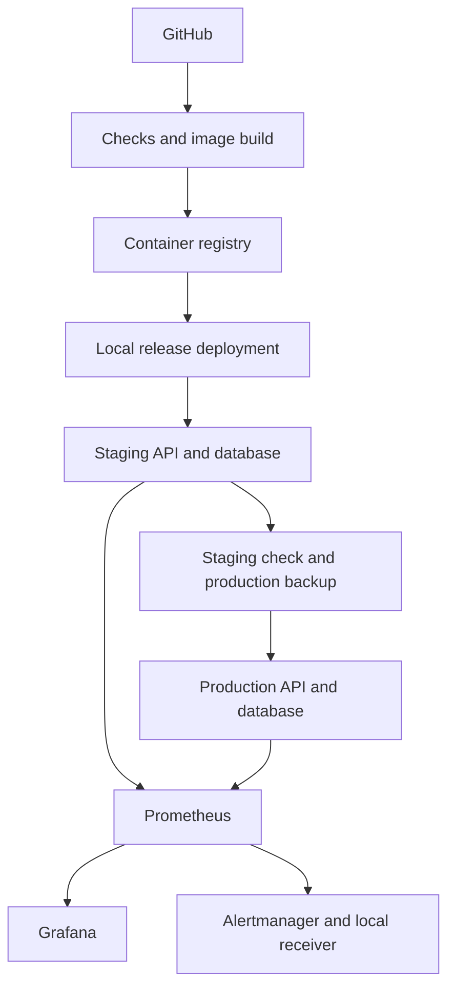
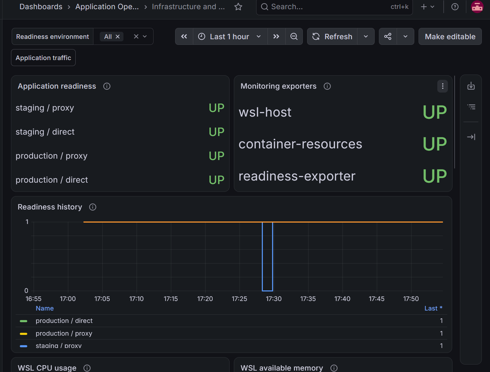

# Application Operations Platform

A small ticket API used to practise deployment, monitoring, and recovery.
The application runs with PostgreSQL in Docker Compose on a Windows laptop
with WSL. Staging and production have separate databases and networks on
that same machine.

The work started with the API and database, then added release scripts,
CI, monitoring, and failure drills. The [build record](docs/evidence.md#build-order)
links those stages to the commits and checks.

## What it does

The API creates tickets, lists them, and updates their status. It has separate
liveness and database readiness endpoints, plus request metrics for Prometheus.
The rest of the project handles operating that service:

- CI runs code checks, database tests, dependency auditing, and image checks
  before publishing the tested image to GitHub Container Registry.
- Deployment scripts set up the database, apply migrations, and start the API.
  Production deployment requires the same image to be healthy in staging.
- Nginx provides a local entry point for each environment. Ansible calls the
  existing deployment scripts and checks the result.
- Prometheus and Grafana track API traffic, WSL resources, container usage,
  and readiness. Alertmanager sends notifications to a local receiver.
- Recovery exercises cover application rollback, restoring a database backup,
  and recovering from a failed staging startup.

## Layout



The recorded Actions deployments ran while the repository was private.
CI and image publishing still run publicly, but deployment jobs retain their
private-repository guard. Current local deployments use the scripts or Ansible.
See [Actions deployment scope](docs/runbooks/actions-deployments.md#public-repository-status).

## Run locally

You need Docker Compose and Bash. On Windows, use WSL with Docker Desktop
integration enabled. Tests use Python 3.14 and uv.

From the repository root:

```bash
cp -n .env.example .env
chmod 600 .env
nano .env
```

Set different, nonempty values for `POSTGRES_PASSWORD` and `APP_DB_PASSWORD`.
If the database already exists, keep its current credentials: editing `.env`
does not change database passwords.

```bash
./scripts/start_local.sh
curl --fail http://127.0.0.1:8001/health/ready
```

The development API docs are at <http://localhost:8001/docs>.
[Local setup](docs/setup.md) covers endpoints, test database settings, and daily commands.
This starts the development API and database; use the runbooks below for the other services.

## Checks and recorded results

Run the default code checks:

```bash
./scripts/check.sh
```

At commit `13d65a6`, the local suite passed **103 tests**, with the two database
integration tests skipped by default. Both database tests ran successfully in
[CI run 43427425933](https://github.com/Szin7/application-operations-platform/actions/runs/43427425933),
which also passed the infrastructure checks and published the tested image.
See [Local setup](docs/setup.md#prepare-the-test-database) to run those tests locally.

The lab checks covered a rejected production promotion, backup restoration,
matched firing and recovery notifications, and a staging startup failure.
In the last drill, the staging API deliberately exited with code 42; rollback
restored it, staging ticket data matched, and production protection checks passed.
The [build record](docs/evidence.md) holds the run links, results, and screenshots.

## Monitoring preview



Recorded on 13 November 2026. The four readiness routes cover direct and proxied
access to both environments. The history includes a deliberate staging-proxy
outage. More [dashboard screenshots](docs/evidence.md#infrastructure-dashboard-screenshots)
are in the build record.

## Operating the lab

| Task | Guide |
| --- | --- |
| Start development and run tests | [Local setup](docs/setup.md) |
| Deploy a release or roll back the API | [Deployment and rollback](docs/runbooks/deployment-rollback.md) |
| Work with registry images | [Registry releases](docs/runbooks/registry-releases.md) |
| Read the historical Actions deployment procedure | [GitHub Actions](docs/runbooks/actions-deployments.md) |
| Deploy locally with Ansible | [Ansible](docs/runbooks/ansible-deployments.md) |
| Back up or restore PostgreSQL | [Backup and restore](docs/runbooks/backup-restore.md) |
| Start the local proxies | [Nginx](docs/runbooks/reverse-proxy.md) |
| Monitor application traffic | [Application monitoring](docs/runbooks/monitoring.md) |
| Collect host, container, and readiness metrics | [Infrastructure monitoring](docs/runbooks/infrastructure-monitoring.md) |
| Check alerts and notification delivery | [Monitoring alerts](docs/runbooks/monitoring-alerts.md) |
| Audit locked Python dependencies | [Dependency checks](docs/runbooks/dependency-checks.md) |
| Repeat the staging recovery drill | [Staging recovery](docs/runbooks/staging-recovery.md) |
| Inspect the running services without a failure drill | [Service check](docs/demo.md) |

Staging uses ports **8082** through Nginx and **8002** directly. Production uses
**8083** through Nginx and **8003** directly. All bind to local loopback addresses.

This is a single-laptop lab. The [scope and limitations](docs/limitations.md)
cover local access, backups, deployment guards, and what the recovery checks establish.
