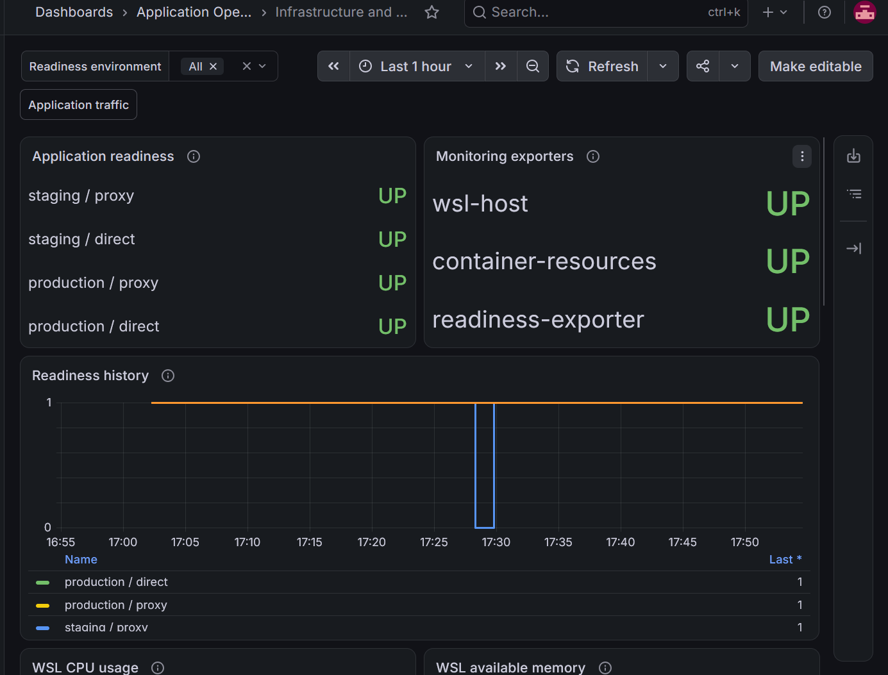
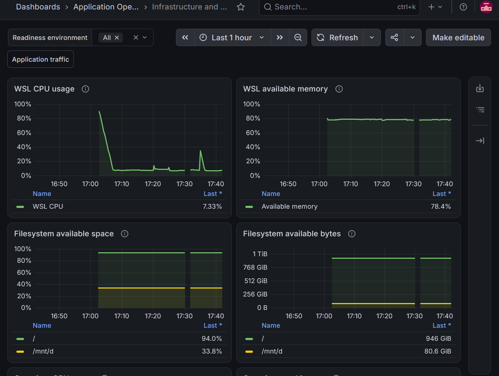
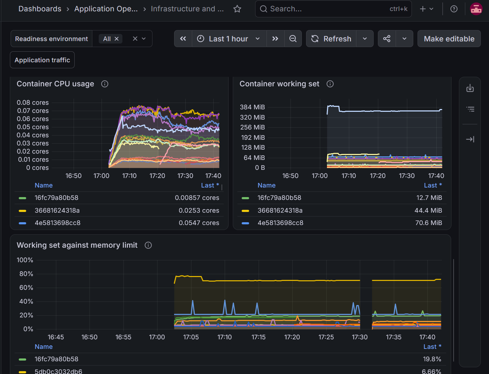
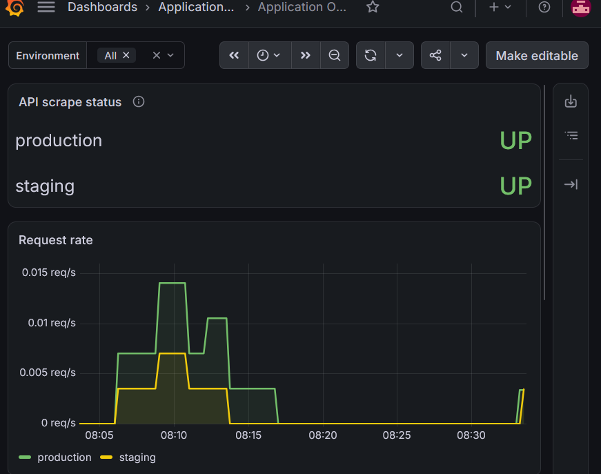
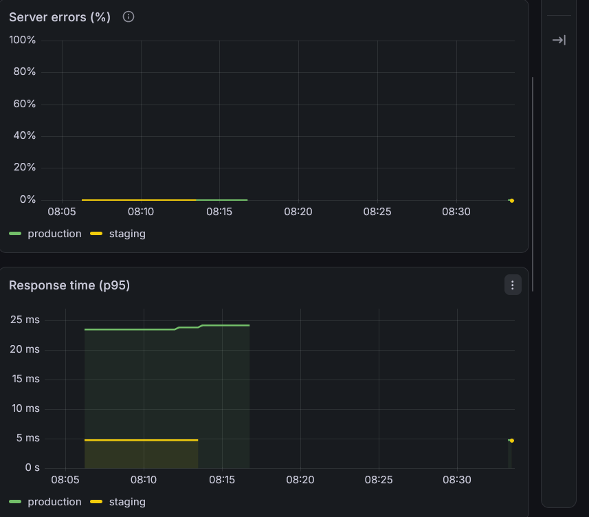
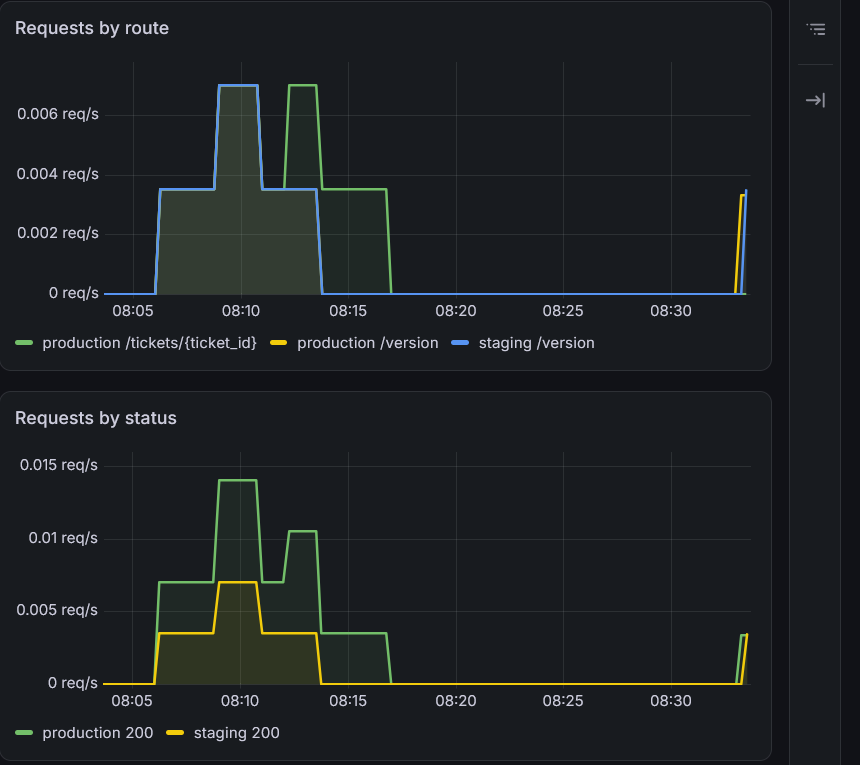

# Build record

The work below ran on one WSL laptop on 12–13 November 2026. This page keeps
the build order, test results, and screenshots together. Dates and times are
UTC, matching GitHub and the local record filenames.

## Build order

These are checkpoints from the commit history. Related commits are grouped
for readability; the dates are commit dates, not estimates of time spent.

| Date (UTC) | Work added | Commit checkpoint |
| --- | --- | --- |
| 12 Nov | API, database readiness, ticket migration, and database tests | [`9e9bcc5`](https://github.com/Szin7/application-operations-platform/commit/9e9bcc5) |
| 12 Nov | API and PostgreSQL in Compose | [`9a76d61`](https://github.com/Szin7/application-operations-platform/commit/9a76d61) |
| 12 Nov | Database backup and restore scripts | [`0ea2bcf`](https://github.com/Szin7/application-operations-platform/commit/0ea2bcf) |
| 12 Nov | Separate staging and production settings | [`703d57a`](https://github.com/Szin7/application-operations-platform/commit/703d57a) |
| 12 Nov | Release deployment, then application rollback | [`0db0375`](https://github.com/Szin7/application-operations-platform/commit/0db0375), [`b12c5df`](https://github.com/Szin7/application-operations-platform/commit/b12c5df) |
| 12 Nov | CI checks, then publishing tested images | [`26f9031`](https://github.com/Szin7/application-operations-platform/commit/26f9031), [`4f28d94`](https://github.com/Szin7/application-operations-platform/commit/4f28d94) |
| 12 Nov | Request metrics, Prometheus, Grafana, and local alert delivery | [`74191c7`](https://github.com/Szin7/application-operations-platform/commit/74191c7) through [`a56088c`](https://github.com/Szin7/application-operations-platform/commit/a56088c) |
| 12–13 Nov | Local runner checks and manual Actions deployments | [`e3c2e84`](https://github.com/Szin7/application-operations-platform/commit/e3c2e84) through [`27e0c00`](https://github.com/Szin7/application-operations-platform/commit/27e0c00) |
| 13 Nov | Nginx proxies | [`9075ca3`](https://github.com/Szin7/application-operations-platform/commit/9075ca3) |
| 13 Nov | Ansible deployment rehearsals | [`598ba82`](https://github.com/Szin7/application-operations-platform/commit/598ba82) |
| 13 Nov | Python dependency audit in CI | [`4ae2a4f`](https://github.com/Szin7/application-operations-platform/commit/4ae2a4f) |
| 13 Nov | Host, container, and readiness monitoring | [`1ecf2ff`](https://github.com/Szin7/application-operations-platform/commit/1ecf2ff) |
| 13 Nov | Failed staging startup and recovery | [`13d65a6`](https://github.com/Szin7/application-operations-platform/commit/13d65a6) |

The application deployed in the later exercises stayed at `a56088c1b7bb`,
version `0.1.2`. Later commits added operations tooling and documentation.
Publishing their images did not update the running applications.

## Delivery checks

CI and image publishing remain enabled publicly. The staging and production
Actions runs below took place while the repository was private. Their jobs
now skip because of the private-repository guard.

| Check | Result | Run |
| --- | --- | --- |
| Final recovery-integration CI | Checks and image publishing passed for `13d65a6`, including both database integration tests | [43427425933](https://github.com/Szin7/application-operations-platform/actions/runs/43427425933) |
| Monitoring-integration CI | Checks and publishing passed for `1ecf2ff` | [43423286458](https://github.com/Szin7/application-operations-platform/actions/runs/43423286458) |
| CI for the deployed release | Passed for `a56088c1b7bb` | [43302633612](https://github.com/Szin7/application-operations-platform/actions/runs/43302633612) |
| Staging deployment | Release checked; production not restarted | [43344606433](https://github.com/Szin7/application-operations-platform/actions/runs/43344606433) |
| Production promotion | Backup created; original ticket preserved | [43347528825](https://github.com/Szin7/application-operations-platform/actions/runs/43347528825) |
| Invalid promotion | Rejected before backup or deployment | [43351535975](https://github.com/Szin7/application-operations-platform/actions/runs/43351535975) |

### Why one workflow is red

The promotion test supplied a CI run where a successful staging deployment
run was required. The workflow rejected it with:

> Choose a successful staging deployment from main.

Backup and deployment were skipped. Local comparisons found no change to
the containers, readiness, versions, production ticket, saved release, or
backup directories. This checked one wrong-workflow input. The
[rejection record](runbooks/actions-deployments.md#verified-rejection-check)
has the details.

## Recovery checks

The first application rollback restored the previous image without changing
the database schema. The original ticket survived the switch. See the
[12 November rollback result](runbooks/deployment-rollback.md#verified-exercise-12-november-2026).

On 13 November, production backup `20261113T014802Z-JkSafR` was restored into
`appops_restore_20261113022643` in the test PostgreSQL container. The archive
checksum passed, migration revision was `0001`, application access worked as
`appops_test_app`, and every field of the demonstration ticket matched.
Readiness passed through FastAPI TestClient. Production stayed on its original
database and its container and ticket checks passed.

The [backup runbook](runbooks/backup-restore.md#verified-production-backup-recovery)
contains the procedure and results. This was a separate-database restore with
one demonstration ticket, not a production database switch.

## Nginx integration

The staging proxy was checked first, then production. Both passed readiness,
route and query forwarding, matching 404 and 422 responses, and a 413 response
for oversized requests. The API and database containers were unchanged.

Runtime checks covered the non-root user, read-only settings, capability
restrictions, resource limits, rotating logs, loopback ports, and separate
networks. The record is
`backups/proxy-check-20261113T042015231868Z.json`.
See [Nginx](runbooks/reverse-proxy.md) for commands and configuration details.

## Ansible deployment rehearsals

Ansible reused the deployment scripts after Nginx was working. Staging and
production each passed check mode and a live same-release rehearsal. Both
retained `a56088c1b7bb`; all runs ended with zero failures or unreachable hosts.

Check mode made no changes. The staging live run reported two changes;
production reported three, including backup
`backups/20261113T050247Z-OWcabu`. Readiness, image/version, saved release,
production ticket, and protected-container checks passed.

These rehearsals did not exercise a new migration or restore the new backup.
[Ansible deployment notes](runbooks/ansible-deployments.md#verified-rehearsals--13-november-2026)
include both local record filenames and the full procedure.

## Python dependency baseline

The first audit used `pip-audit 2.10.1` against checkout `598ba82` in WSL.
It checked 31 applicable locked Python packages, skipped none, and reported
no known vulnerabilities. Its local output is in
`backups/dependency-audit-20261113T052751Z-HgBtxd`.

This is a dated result for Python dependencies, not a container-image scan.
The audit then passed as part of the CI runs linked above. See
[Dependency checks](runbooks/dependency-checks.md) for coverage and failure handling.

## Infrastructure monitoring sequence

Host metrics needed extra work on WSL: the original filesystem collector
failed on the mount format. The local Node Exporter build uses the released
procfs fix and tests the failing format. cAdvisor collects from cgroup v2
because the tested runtime socket paths were unavailable. The
[exporter build notes](../deploy/node-exporter/README.md) and
[container runbook](runbooks/container-monitoring.md#why-this-configuration)
explain those choices.

The live checks ran in this order on 13 November:

| Time (UTC) | Check | Result |
| --- | --- | --- |
| 06:57 | WSL host metrics | Five collectors passed; 12 CPUs, memory, and two filesystems matched WSL |
| 07:05 | Host scrape | Prometheus ingested those metrics |
| 07:35 | Container metrics | CPU, memory, and freshness passed for 15 running containers |
| 07:46 | Readiness probes | Four HTTP/body probes passed; 16 lab containers checked |
| 11:17 | Resume after a pause | Existing container IDs and images preserved; collection and readiness passed |
| 11:35 | Alert rules | All 11 loaded rules were healthy and inactive |
| 11:42–11:47 | Alert delivery | Staging proxy and host exporter each produced firing and matching resolved notifications |
| 11:56 | Dashboard queries | Ten panel queries and both readiness filters passed |

Each outage drill restarted only its selected target. Production readiness
and original-ticket checks passed. Local records remain under `backups/`;
procedures and record names are in the
[infrastructure](runbooks/infrastructure-monitoring.md),
[alert](runbooks/monitoring-alerts.md), and
[dashboard](runbooks/infrastructure-dashboard.md) runbooks.

## Staging startup failure and recovery

After monitoring was complete, the staging API was given a temporary startup
command that exited with code 42. Both staging routes became unavailable.
The existing rollback script restored the saved image; all four readiness
routes then passed. The staging migration and all ticket rows matched their
starting values. Protected containers and production settings were unchanged,
and the original production ticket matched at each sampled protection check.

The result is in
`backups/staging-recovery-20261113T123703731666Z/evidence.json`.
The [recovery runbook](runbooks/staging-recovery.md#verified-exercise--13-november-2026)
explains the temporary configuration fault and cleanup. The local test run
passed 103 tests and skipped the two opt-in database integration tests.
Those two tests subsequently passed in CI.

A final monitoring check at 12:42 UTC found fresh metrics for all 16 lab
containers, including the replacement staging API. All ten dashboard queries
and both environment filters passed. Its record is
`backups/infrastructure-dashboard-check-20261113T124209764681Z.json`.

Raw logs, database archives, and JSON records stay local and are excluded from
Git. The summaries here describe the recorded checks, not a live status page.

## Infrastructure dashboard screenshots

Captured on 13 November 2026 from the running local dashboard. These views
show measured lab usage, not a benchmark. Gaps during the host-exporter
outage represent unavailable data, not measured zeros.

### Readiness and exporter status

The final view shows four readiness routes and three exporters UP, with
readable status labels. Readiness history records the deliberately stopped
staging proxy dropping to zero and recovering. The direct staging route
and both production routes stayed ready during that drill.

### Host resources and filesystem capacity

The screenshot shows approximately 7.33% WSL CPU usage and 78.4% available
memory at its right edge. The root filesystem reports virtual WSL capacity;
Windows D: is shown separately as `/mnt/d`, with about 80.6 GiB available.

### Container resources

CPU is plotted in cores, memory as working set, and limited containers
as a percentage of their configured memory limit. Legends use current
container IDs because the raw cgroup collector does not provide service names.
Use `docker ps --format 'table {{.ID}}\t{{.Names}}'` to map them to names.

## Monitoring screenshots

Captured from the local Grafana dashboard on 13 November 2026. These are
recorded views of light demo traffic, not a performance benchmark or live
service status.

### Scrape status and traffic

Both production and staging scrape targets show **UP**, with application
request traffic recorded for each environment.

### Errors and response time

The plotted server-error percentages are zero. The earlier p95 response-time
samples are approximately 23–24 ms for production and 4–5 ms for staging.
The sparse samples do not establish comparative performance. Empty intervals
are not measured zeros; see the [monitoring runbook](runbooks/monitoring.md#read-the-dashboard).

### Routes and status codes

The dashboard groups traffic by environment and route template, and records
HTTP 200 responses for the displayed requests.

To inspect the running lab, use the [service check](demo.md).
